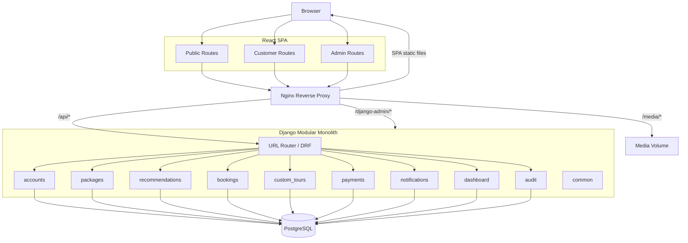
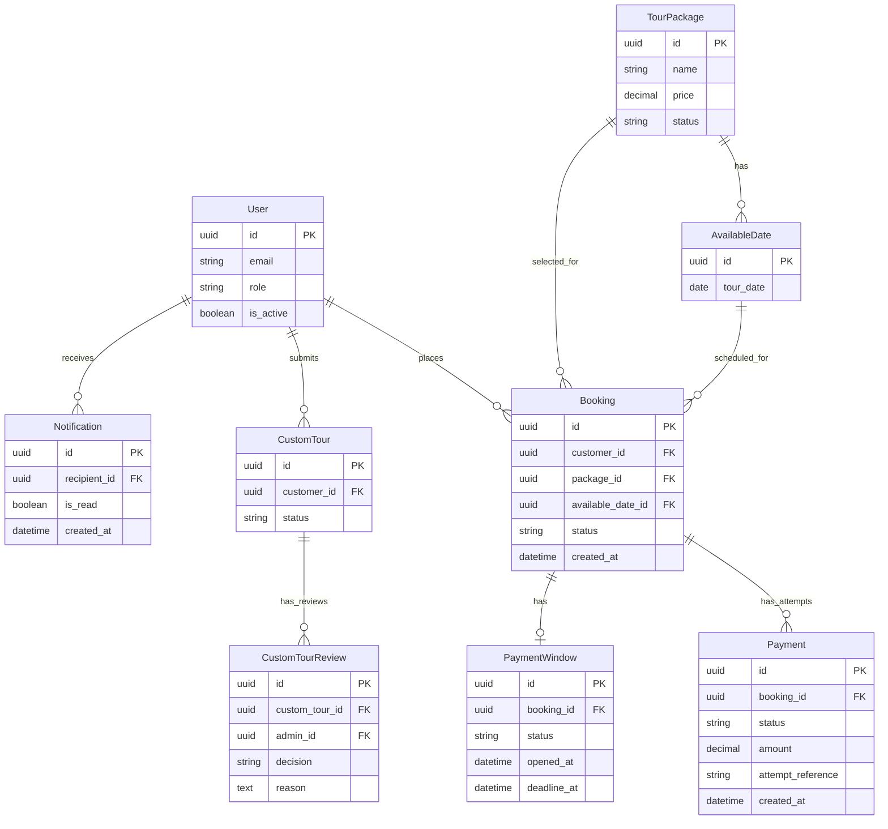

# Architecture Spine — Tour Portal

## 1. Purpose

This document defines the technical architecture and implementation boundaries for the Tour Portal MVP.

It serves as the primary technical reference for developers and AI coding agents during implementation.

It establishes:

- System structure and architectural boundaries.
- Frontend and backend organization.
- Authentication and authorization.
- Domain ownership and service responsibilities.
- Booking, payment, and custom-tour business-rule enforcement.
- Data integrity and transaction requirements.
- API conventions and cross-cutting responsibilities.
- Local development and deployment baseline.
- Minimum testing expectations.

Product behavior and business requirements remain governed by the PRD and BRD. UX behavior remains governed by the UX design documents.

When implementation details are not explicitly defined here, follow the relevant product requirements rather than introducing new business behavior.

## 2. Design Paradigm

**Modular monolith** (Django apps organized by business domain) + **single-page application** (React route groups).

### System structure

| Layer | Responsibility | Technology |
|---|---|---|
| Presentation | Public, Customer, and Admin interfaces | React |
| Routing | Frontend route management | React Router |
| API / HTTP | Request handling, serialization, validation | Django REST Framework |
| Domain services | Business workflows and state transitions | Django service modules |
| Persistence | Data models and database access | Django ORM |
| Database | Relational data storage | PostgreSQL |
| Reverse proxy | Same-origin routing and static delivery | Nginx |
| Local runtime | Development environment and service orchestration | Docker Compose |

### Architectural boundaries

- One React SPA.
- One Django + DRF backend application.
- One PostgreSQL database.
- One shared authentication and authorization system.
- Customer and Admin interfaces are separate route groups within the same SPA.
- Django domain apps are internal modules, not independently deployed services.
- Frontend communicates with the backend through `/api/*` only.
- Business logic belongs in backend services, not frontend components or HTTP views.

### System flow



### Dependency rules

1. Frontend communicates with backend through HTTP APIs only.
2. Django apps may use shared utilities from `common/`.
3. Django apps must not import or depend on another app's views.
4. Cross-domain operations must go through explicit service interfaces.
5. Avoid circular imports and bidirectional domain dependencies.
6. Domain services own business rules; serializers and views handle HTTP concerns.
7. Database access must use Django ORM rather than direct database queries scattered across the application.

## 3. Adopted Architecture Decisions

### AD-1 — Single SPA + Single API + Single Database `[ADOPTED]`

**Binds:** All MVP surfaces.

**Prevents:** Separate Customer/Admin frontends, multiple databases, premature microservices.

**Rules:**

- One React + Vite SPA.
- One Django + DRF backend application.
- One PostgreSQL database.
- Public, Customer, and Admin interfaces share the same frontend application.
- All application data is managed through the shared backend.

### AD-2 — Same-Origin Session Authentication `[ADOPTED]`

**Binds:** Authentication, sessions, CSRF, and cookies.

**Prevents:** JWT complexity for MVP, authentication secrets in localStorage, cross-origin session complications.

**Rules:**

- Use Django session authentication with DRF `SessionAuthentication`.
- Session authentication is cookie-based.
- Session cookie must be HttpOnly.
- Session cookie must use Secure in production.
- Configure an appropriate SameSite policy.
- CSRF protection is mandatory for unsafe HTTP methods.
- Authentication tokens or session secrets must not be stored in localStorage.
- Frontend must obtain and submit the CSRF token for protected mutations.

**Authentication endpoints:**

| Method | Endpoint | Purpose |
|---|---|---|
| POST | `/api/auth/register/` | Customer self-registration |
| POST | `/api/auth/login/` | Authenticate user |
| POST | `/api/auth/logout/` | End user session |
| GET | `/api/auth/me/` | Retrieve authenticated user |
| GET | `/api/auth/csrf/` | Bootstrap CSRF token |

**Additional rules:**

- `POST /api/auth/register/` creates `CUSTOMER` accounts only; role cannot be set to `ADMIN` by the client; duplicate email is rejected.
- Password hashing must use Django password hashers only; never log plaintext passwords.
- `GET /api/auth/me/` is used during SPA initialization to restore authentication state and returns `role`, `is_staff`, and `is_superuser`.
- Frontend route guards use `role` only.
- Logout invalidates the authenticated session.
- Session expiration must be handled by the shared frontend HTTP client (see AD-21).
- Session cookie: `HttpOnly`, `Secure` in production, `SameSite=Lax`.
- CSRF cookie name `csrftoken` (readable by JS); header `X-CSRFToken`; `CSRF_COOKIE_HTTPONLY = False`.
- Login must apply basic rate limiting / lockout against repeated failed attempts.
- Password reset and account recovery must follow the PRD scope (deferred in MVP unless PRD changes).

### AD-3 — Server-Enforced RBAC + Object Ownership `[ADOPTED]`

**Binds:** Every protected resource and API endpoint.

**Prevents:** Frontend-only authorization, treating `is_staff` as application Admin, public Admin signup, mixed role/staff seed states.

**Roles:**

- `CUSTOMER`
- `ADMIN`

**Rules:**

- Public catalog endpoints may be accessed without authentication.
- Customer APIs require an authenticated Customer (`role == CUSTOMER`).
- Admin APIs require an authenticated Admin (`role == ADMIN` only — never `is_staff` alone).
- Customers may only access their own bookings, custom-tour requests, payments, and notifications.
- Admins may access authorized administrative resources.
- Object ownership must be checked on the backend for every protected resource.
- Frontend route guards are for user experience only, not security.
- Public Admin registration is not permitted.
- Admin accounts are seeded or provisioned through an authorized process.

**Django permission distinction:**

- Application roles (`CUSTOMER` and `ADMIN`) govern application-level authorization.
- Django `is_staff` controls access to Django Admin.
- Django `is_superuser` is a separate elevated permission and must not automatically be treated as the normal application Admin role.
- Access to `/django-admin/*` requires the appropriate Django staff permissions.
- **MVP seed invariant:** application `ADMIN` ⇒ `is_staff=True`; reject `{role:ADMIN, is_staff:False}` and `{role:CUSTOMER, is_staff:True}` unless an explicit ops break-glass role is documented later.

### AD-4 — Domain Apps + Service Layer `[ADOPTED]`

**Binds:** Backend organization and business logic placement.

**Prevents:** Fat views with embedded workflows, cross-app ORM writes without service interfaces, microservice/event-bus sprawl in MVP.

**Backend apps:**

| App | Responsibility |
|---|---|
| `accounts` | Authentication, users, roles, profiles |
| `packages` | Tour packages, availability dates, package information, search/filter, media metadata |
| `recommendations` | AI-powered catalog recommendations (grounded on published packages only) |
| `bookings` | Customer bookings and booking lifecycle |
| `custom_tours` | Custom-tour requests and Admin reviews |
| `payments` | Payment windows, payment attempts, mock provider |
| `notifications` | In-app notifications and read state |
| `dashboard` | Customer and Admin dashboard read-model APIs |
| `audit` | Administrative action history |
| `common` | Shared permissions, exceptions, pagination, utilities |

**Rules:**

- Complex business workflows belong in `services/`.
- Views must remain thin and HTTP-focused.
- Serializers handle request validation and response serialization.
- Services coordinate domain operations.
- Use `transaction.atomic` for critical multi-row operations.
- Avoid unnecessary repository abstractions, event buses, and microservice patterns.
- A domain app must not insert/update/delete another app's models except through that app's defined service interface (reads for dashboards: see AD-18).

**Binding service ownership** (exclusive for the named writes):

| Service | Responsibility |
|---|---|
| `BookingService` | Booking creation, approval, rejection, cancellation (must not write `PaymentWindow` rows) |
| `PackageService` | Package, availability, search/filter query, media metadata operations |
| `RecommendationService` | AI recommendation generation against published packages only |
| `CustomTourService` | Custom-tour submission and review workflows |
| `PaymentService` | Payment eligibility, attempts, and *all* payment-window writes |
| `NotificationService` | *Only* writer of in-app notification rows; read operations |
| `AuditService` | *Only* writer of audit rows |
| `DashboardQueryService` | Aggregated dashboard metrics via domain query methods |

### AD-5 — URL Namespaces `[ADOPTED]`

**Binds:** Frontend routing, backend routing, and reverse proxy configuration.

**Prevents:** Colliding React Admin vs Django Admin paths, routing `/api/*` to the SPA fallback, splitting Public/Customer/Admin into separate origins in MVP.

| Path | Responsibility |
|---|---|
| `/` | Public website |
| `/app/customer/*` | Customer application |
| `/app/admin/*` | Admin application |
| `/api/*` | Django REST API |
| `/media/*` | Uploaded package media (local MVP) |
| `/django-admin/*` | Django built-in Admin |

**Rules:**

- Public, Customer, and Admin paths are handled by the same React SPA.
- `/api/*` routes to Django REST Framework.
- `/django-admin/*` routes to Django Admin.
- `/media/*` is served by Nginx (or Django in local-only fallback) from the media volume.
- Django Admin access is staff-restricted.
- Production Django Admin may be disabled if operationally appropriate.
- Nginx must not route `/api/*`, `/media/*`, or `/django-admin/*` to the React SPA fallback.
- Unknown frontend routes may use the SPA fallback.

### AD-6 — PaymentProvider Abstraction; Mock Only in MVP `[ADOPTED]`

**Binds:** Payment module and payment processing.

**Prevents:** Real card data or Stripe in MVP, payment rules living inside provider adapters, dual payment stacks.

**Rules:**

- Payment processing must be isolated behind a `PaymentProvider` interface.
- MVP implements only `MockPaymentProvider`.
- Real payment gateway integration, including Stripe, is deferred.
- No real card information is collected or stored.
- The UI must clearly display: "Mock payment — no real charges."
- `PaymentService` owns payment eligibility, payment-window rules, attempts, and payment state transitions.
- The provider implementation handles provider-specific processing behavior.
- Future payment providers must not alter booking approval or payment-window business rules.

**Suggested structure:**

```text
payments/
├── models.py
├── serializers.py
├── views.py
├── urls.py
├── services/
│   ├── payment_service.py
│   └── payment_window_service.py
├── providers/
│   ├── base.py
│   └── mock_provider.py
└── tests/
```

### AD-7 — Product State Machines Are Authoritative `[ADOPTED]`

**Binds:** Booking, payment, payment-window, and custom-tour workflows.

**Prevents:** Invented statuses, FE-authoritative transitions, pay-before-approval, auto-cancel on window expiry.

**Rules:** Product status machines below are authoritative; implementers must not invent statuses or FE-driven transitions. The PRD, BRD, and UX documents remain the authority for business behavior detail.

#### Booking status

`PENDING | APPROVED | REJECTED | CANCELLED`

#### Payment status

`UNPAID | PENDING | SUCCESS | FAILED | CANCELLED`

#### Payment-window status

`NOT_OPEN | OPEN | EXPIRED`

#### Custom-tour status

`PENDING | APPROVED | REJECTED`

#### Booking rules

- Customer submits a booking request.
- New booking enters `PENDING`.
- Admin reviews the booking.
- Admin may approve or reject.
- Rejection reason is mandatory.
- Customer may cancel only while booking status is `PENDING`.
- Only an `APPROVED` booking is eligible for payment.

#### Payment-window rules

- Payment window opens after Admin approval via `PaymentService` (see AD-16).
- Payment deadline is 24 hours after the approval timestamp.
- Payment remains available while the window is open.
- If payment is not completed within the deadline, the window expires.
- Expiration does not automatically cancel the approved booking.
- Payment retry is permitted after failed or cancelled attempts while the payment window remains open.
- Reopening payment access does not reset the original deadline.
- Only an explicit Admin extension changes the deadline.
- Payment eligibility must be validated on the backend.

#### Custom-tour rules

- Customer submits a custom-tour request; new requests enter `PENDING`.
- Admin reviews the request.
- Admin may approve or reject it (`APPROVED` | `REJECTED`).
- Rejection requires a reason; Admin adjustments and review decisions must be retained.
- Customer may reapply according to the PRD-defined workflow (reapply returns the request to `PENDING`).
- Approved custom tours remain private to the requesting Customer.
- Admin approval must enforce the same 7-day advance validator as bookings (AD-20).
- Quotations and quotation acceptance workflows are excluded from MVP.

### AD-8 — Transaction Integrity, Concurrency, and Idempotency `[ADOPTED]`

**Binds:** Booking, approval, payment, and payment-window operations.

**Prevents:** Seat/capacity inventory, dual successful payments, non-atomic approval+window opens, FE-trusted payment outcomes.

**Rules:** Enforce transaction integrity, concurrency control, and payment idempotency as specified in the subsections below. Purpose: prevent inconsistent business state caused by simultaneous requests, retries, or duplicate submissions.

#### Booking and availability (MVP)

- **No seat capacity.** Forbidden concepts and fields: `capacity`, `seats`, `remaining`, `slots`, `max_bookings`, `slots_taken`, and any UI copy implying limited seats or “fully booked.”
- Available dates are Admin-defined **calendar options** only (subject to the **7 calendar-day advance** rule). Selecting a date does not consume or reserve capacity.
- Concurrent bookings for the same `AvailableDate` are **allowed** (N customers may book the same calendar option); do not add uniqueness on `(package, date)` across customers.
- Do not add UI, API fields, models, or tests that imply limited seats.
- Date eligibility and 7-day advance validation must be enforced on the backend via the shared validator (AD-20).
- Frontend date checks are informational and must never be the sole enforcement mechanism.
- Booking creation, approval, rejection, and cancellation must follow PRD lifecycle rules (including Admin blocked from approving when the 7-day rule fails at approval time).

#### Payment attempts

- Each payment attempt must have a distinct identity.
- Duplicate payment requests must be handled idempotently.
- A repeated request must not create duplicate successful payment processing.
- Payment success must be processed only once.
- Failed or cancelled attempts must remain available for history and audit.
- Payment retries must follow the payment-window eligibility rules.
- The backend must validate payment outcomes rather than trusting frontend state.
- The system **must** prevent multiple concurrent active payment attempts for the same booking from producing duplicate `SUCCESS` outcomes.

#### Transactions

Use `transaction.atomic` for critical operations, including:

- Booking approval and payment-window creation (approve calls `PaymentService.open_window_for_booking` inside the same atomic block).
- Payment attempt creation and state changes.
- Payment-window extension and reopening.
- Notification and audit writes for the closed catalogs (AD-17, AD-22).
- Other operations that update multiple related records.

Do not hold database transactions open while waiting for external provider operations. The mock provider must also follow a clear processing boundary.

### AD-9 — UUID Primary Keys + Database Integrity `[ADOPTED]`

**Binds:** Application entities and database relationships.

**Prevents:** Integer PKs for app entities, capacity columns, dual PaymentWindow rows per booking, orphaned FK deletes of booked dates.

**Rules:**

- Use UUID primary keys for application entities.
- Define appropriate foreign keys and indexes.
- Use database constraints for critical integrity requirements.
- Enforce unique user email addresses.
- Preserve referential integrity across bookings, payments, packages, and customer-owned resources.
- Avoid redundant relationships where data can be derived reliably through existing foreign keys.
- Business validation must be enforced by backend services even when database constraints exist.
- Do not add capacity, seat count, or remaining-seats columns (see AD-8).
- Exactly one `PaymentWindow` row per booking (DB unique on `booking_id`).
- `AvailableDate` deactivation uses an `is_active` (or equivalent) flag; never delete rows that have booking FKs.

**Data modeling guidance:**

- A Payment belongs to a Booking.
- The Customer associated with a Payment can normally be derived through its Booking.
- A Booking references its Customer, selected package, and selected availability date.
- A PaymentWindow belongs to the relevant Booking (`Booking ||--|| PaymentWindow` once opened; conceptually `||--o|` before open).
- A CustomTourReview references its CustomTour and reviewing Admin.
- Notification belongs to its recipient.
- Audit records identify the actor and affected resource.

The final entity fields and cardinalities must remain consistent with the PRD and implemented workflows.

### AD-10 — Payment Window Is Authoritative and Deadline-Based `[ADOPTED]`

**Binds:** Payment eligibility and payment-window lifecycle.

**Prevents:** Client-trusted deadlines, scheduled-task-only expiry, reopen resetting deadline, multi-window history as competing sources of truth.

**Rules:**

- The approval timestamp is the source for the initial payment deadline.
- The initial deadline is 24 hours after approval.
- Store timestamps in UTC.
- Payment eligibility must compare the current time with the authoritative deadline.
- Expiration must not depend solely on a scheduled task executing on time.
- A scheduled task may update persisted expiration state for reporting or operational purposes.
- The backend must reject payment attempts after the deadline.
- Reopening payment access must preserve the existing deadline.
- An explicit Admin extension updates `deadline_at` on the single window row and **must** call `AuditService` (AD-22); optional `PaymentWindowExtension` rows are supplements only.
- Expiration must not automatically change booking status.
- All PaymentWindow writes go through `PaymentService` / payment-window service in `payments` (AD-16).

**PaymentWindow fields:**

- `id`
- `booking_id` (unique)
- `status`
- `opened_at`
- `deadline_at`
- `expired_at` (optional, for recording expiration processing)
- `created_at`
- `updated_at`

The payment-window service is responsible for evaluating and enforcing eligibility.

### AD-11 — API Conventions `[ADOPTED]`

**Binds:** All JSON API endpoints.

**Prevents:** Custom mandatory error envelopes, inconsistent pagination forks, leaking internal exceptions.

**Rules:**

- All JSON API endpoints use `/api/`.
- Use DRF serializers for request validation and response serialization.
- Use DRF-standard validation and error response formats.
- Do not introduce a mandatory custom `{code, message, details}` response envelope for MVP.
- Pagination default: DRF `PageNumberPagination` with a documented page size (e.g. 20) shared via `common`.
- Filtering and sorting conventions for list endpoints live with the owning domain (packages search: AD-24).
- Return appropriate HTTP status codes.
- Apply authentication and permission checks consistently.
- Do not expose internal exception details or sensitive information in production responses.
- API versioning may be introduced later if required; the MVP uses `/api/`.

### AD-12 — Notifications and Audit Responsibilities `[ADOPTED]`

**Binds:** Notifications and administrative activity history.

**Prevents:** Domain services writing notification/audit rows directly, open-ended event vocabularies, best-effort audit for the closed catalog, silent notification loss on critical ops.

**Rules:** Notifications and audit follow exclusive writers and closed catalogs (detail in subsections and AD-17 / AD-22).

#### Notifications

- In-app notifications are the MVP notification channel.
- Only `NotificationService` may insert `Notification` rows (AD-17).
- Notifications belong to a specific recipient.
- Read/unread state is stored in the database.
- Opening a notification marks it as read, following the UX behavior.
- Closed MVP event catalog and idempotency key are defined in AD-17.
- Important business operations must not silently lose their associated notification records.

Notification delivery must be coordinated with the business transaction. For operations requiring atomic consistency, create the notification record within the same database transaction via `NotificationService`. External delivery, if introduced later, should be handled separately. No post-commit-only creation for MVP in-app records.

#### Audit

Closed MVP audit actions **must** call `AuditService.record` inside the same atomic block as the state change (AD-22):

- Booking approval and rejection.
- Custom-tour approval and rejection.
- Payment-window reopening and extension.
- Important package and availability changes.
- Other sensitive Admin actions added only by amending the closed catalog.

Audit records must include:

- Actor.
- Action (from the closed catalog).
- Target entity and identifier.
- Timestamp.
- Relevant before/after values or decision details.

Audit history must not be editable through normal application workflows. Only the `audit` app may insert audit rows.

## 4. Frontend Architecture

### AD-13 — Feature-Based React Organization `[ADOPTED]`

**Binds:** Frontend application structure.

**Prevents:** Pages-by-type sprawl, per-feature HTTP clients, FE as authority for authz/payment eligibility.

**Rules:** Organize the SPA by route groups and business features as below; all API calls go through the shared client (AD-21); FE never authorizes business state.

#### Route groups

| Route group | Layout | Purpose |
|---|---|---|
| Public | `PublicLayout` | Landing page and public package discovery |
| Customer | `CustomerLayout` | Customer dashboard and booking workflows |
| Admin | `AdminLayout` | Administrative management and review workflows |

#### Suggested structure

```text
frontend/
├── public/
├── src/
│   ├── app/
│   │   ├── router/
│   │   ├── providers/
│   │   └── guards/
│   ├── layouts/
│   │   ├── PublicLayout.jsx
│   │   ├── CustomerLayout.jsx
│   │   └── AdminLayout.jsx
│   ├── features/
│   │   ├── auth/
│   │   ├── packages/
│   │   ├── recommendations/
│   │   ├── bookings/
│   │   ├── custom-tours/
│   │   ├── payments/
│   │   ├── notifications/
│   │   └── dashboard/
│   ├── components/
│   │   ├── ui/
│   │   └── shared/
│   ├── services/          # shared apiClient lives here (AD-21)
│   ├── hooks/
│   ├── utils/
│   ├── App.jsx
│   └── main.jsx
├── index.html
├── package.json
└── vite.config.js
```

#### Feature organization

A feature may contain:

- Components.
- Pages.
- Hooks.
- API/service functions.
- Validation schemas.
- Feature-specific utilities.
- Tests.

Shared UI components belong in `components/ui/`.

Reusable application-level components belong in `components/shared/`.

Frontend responsibilities:

- Render UI and manage interaction state.
- Perform client-side validation for usability.
- Communicate with the backend **only** through the shared `apiClient` (AD-21).
- Handle authentication bootstrap and session expiration via that client.
- Display loading, empty, success, and error states.
- Protect route navigation for usability (using `role` from `/me/`).
- Never act as the authority for permissions, payment eligibility, or business-state transitions.
- Dashboard KPI tiles consume `dashboard` APIs only — no client-side re-aggregation of domain list endpoints for those same metrics (AD-18).

## 5. Data Model and Domain Ownership

The following is the conceptual entity relationship structure. It is a starting point for implementation, not a replacement for the detailed data requirements in the PRD.



### Domain ownership

| Domain | Owns |
|---|---|
| Accounts | User identity, roles, profiles |
| Packages | Package information, available dates, search/filter, media metadata |
| Recommendations | AI recommendation requests/results grounded on published packages |
| Bookings | Booking records and booking status |
| Custom Tours | Custom-tour requests and review history |
| Payments | Payment attempts and payment-window state (exclusive window writes) |
| Notifications | In-app notification records and read state (exclusive creates) |
| Dashboard | Aggregated dashboard read-model APIs |
| Audit | Administrative action history (exclusive creates) |

A domain app must not directly manipulate another app's internal state without using its defined service interface. Exclusive writers for side-effect entities are locked in AD-16…AD-22.

## 6. Cross-Cutting Conventions

| Concern | Convention |
|---|---|
| Naming | Django apps: snake_case |
| Frontend feature folders | kebab-case |
| Python modules | snake_case |
| React components | PascalCase |
| IDs | UUID primary keys |
| Date/time storage | UTC |
| Business calendar rules | Single configured business timezone (`BUSINESS_TIMEZONE` = `Asia/Dhaka`) |
| API prefix | `/api/` |
| API errors | DRF-standard responses |
| Authentication | Django session authentication |
| CSRF | Required for unsafe HTTP methods |
| Authorization | Backend RBAC + object ownership |
| Transactions | `transaction.atomic` for critical multi-row operations |
| Logging | Structured application logging |
| Correlation | Request/correlation identifier where appropriate |
| Audit | Record important Admin decisions and sensitive changes |
| Configuration | Environment-based settings |
| Secrets | Never commit secrets to version control |

### Timezone rules

- Store timestamps in UTC.
- Use timezone-aware datetime values.
- Convert timestamps to the configured business timezone for business-calendar calculations and display.
- The 24-hour payment deadline is elapsed time from the approval timestamp, not a calendar-day calculation.
- The PRD's 7-calendar-day booking advance rule must use the configured business timezone.

## 7. Testing Strategy

### AD-14 — Layered Testing Strategy `[ADOPTED]`

**Binds:** MVP quality gate and critical scenario coverage.

**Prevents:** FE-only verification of authz/payment rules; shipping without the listed critical backend scenarios.

**Rules:** Cover the layered responsibilities and mandatory critical scenarios below; framework pins may be chosen at implementation. Testing must verify backend enforcement, not just frontend behavior.

| Layer | Responsibility |
|---|---|
| Backend unit tests | Service logic, validation, state transitions |
| Backend integration tests | Database integrity, permissions, API behavior |
| Frontend component tests | UI behavior, form validation, component states |
| API integration tests | Customer/Admin API workflows |
| E2E tests | Complete user journeys across frontend and backend |

### Critical scenarios

The implementation must include tests for:

1. Customer cannot access another Customer's booking.
2. Customer cannot access Admin APIs.
3. Customer cannot pay before booking approval.
4. Payment is unavailable after the payment deadline.
5. Failed payment can be retried while the payment window is open.
6. Reopening payment access does not reset the original deadline.
7. Explicit Admin extension updates the deadline.
8. Expired payment window does not automatically cancel the booking.
9. Duplicate payment submissions do not create duplicate successful processing.
10. Concurrent payment attempts for the same booking do not create duplicate `SUCCESS` outcomes.
11. Rejected booking requires a rejection reason.
12. Custom-tour review and reapplication follow the PRD workflow.
13. Notifications are created for relevant business events.
14. Admin decisions are recorded in the audit history.
15. Booking dates within the next 7 calendar days are rejected on the backend.
16. AI recommendation failure does not break catalog browse/search.
17. Search results exclude unpublished packages.
18. Registration creates CUSTOMER only and rejects duplicate email.

Testing must verify backend enforcement, not just frontend behavior. The listed critical scenarios are mandatory backend (and where relevant E2E) coverage before merge.

## 8. Runtime and Local Development

### AD-15 — Docker Compose Local Baseline; Cloud Unbound `[ADOPTED]`

**Binds:** Local development and integration environment.

**Prevents:** Per-developer ad-hoc runtimes without Compose, secrets in VCS, cloud lock-in before deploy planning.

**Rules:**

- Use Docker Compose as the local development baseline.
- Frontend, backend, and PostgreSQL run as separate services.
- PostgreSQL uses a persistent volume; media files use a dedicated volume mounted for `/media/`.
- Nginx or an equivalent reverse proxy provides same-origin routing.
- Environment-specific configuration is used.
- Database migrations are managed through Django migrations.
- Seed data supports repeatable local setup (Admin users must satisfy AD-3 seed invariant).
- Compose **must** define healthchecks for PostgreSQL and the backend.
- Database readiness must be considered before backend initialization.
- Secrets must be supplied through environment configuration, not committed to source control.

**Local env baseline (non-secret defaults / required keys):**

| Key | Purpose |
|---|---|
| `DJANGO_SECRET_KEY` | Secret (never commit) |
| `DATABASE_URL` / Postgres vars | DB connection |
| `BUSINESS_TIMEZONE` | Calendar-rule timezone (`Asia/Dhaka`) |
| `CSRF_TRUSTED_ORIGINS` | Same-origin Compose/public URL |
| `MEDIA_ROOT` / media volume path | Package images |
| `AI_PROVIDER` / related keys | Recommendation provider config (may be `mock` locally) |

### Suggested runtime structure

```text
/
├── frontend/
├── backend/
├── deploy/
│   ├── docker-compose.yml
│   └── nginx/
│       └── default.conf
├── docs/
│   └── tour-portal/
│       ├── PRD.md
│       └── BRD.md
├── _bmad-output/planning-artifacts/architecture/.../
│   ├── ARCHITECTURE-SPINE.md
│   └── ARCHITECTURE-WALKTHROUGH.md
└── README.md
```

### Production considerations

Before deployment, define:

- HTTPS/TLS termination.
- Production session and CSRF cookie configuration.
- Static asset serving.
- Database backup and recovery approach.
- Application health checks.
- Error monitoring and logging.
- Migration execution strategy.
- Secret management.

The cloud hosting provider remains unbound until deployment planning.

### AD-16 — Exclusive PaymentWindow Ownership `[ADOPTED]`

**Binds:** Payment-window model and all create/expire/reopen/extend writes.

**Prevents:** Dual writers (`BookingService` vs `PaymentService`), 1:N window rows as competing truth, orphan OPEN windows after cancel/reject.

**Rules:**

- `PaymentWindow` model and *all* writes live exclusively in `payments`.
- On successful booking **create**, `BookingService` must call `PaymentService` to create **exactly one** `PaymentWindow` for that booking with status `NOT_OPEN` (same `transaction.atomic`); it must not write `PaymentWindow` ORM rows directly.
- On successful custom tour **create**, `CustomTourService` must call `PaymentService.create_not_open_for_custom_tour` the same way (exactly one window; amount = estimated budget).
- `BookingService.approve()` must call `PaymentService.open_window_for_booking(booking, approval_timestamp=…)` inside the same `transaction.atomic` to **update that existing row** to `OPEN` and set `deadline_at = approval_timestamp + 24 hours`; it must not create a second window or write `PaymentWindow` ORM rows directly.
- `CustomTourService.approve()` must call `PaymentService.open_window_for_custom_tour` the same way (private tour; never publishes to catalog).
- Cardinality: exactly one `PaymentWindow` per booking **or** per custom tour (XOR owner; unique on the non-null owner FK); extension mutates `deadline_at` on that row; history goes to audit and optionally `PaymentWindowExtension` — never a second window.
- Before approval, payment remains `UNPAID` (or absent attempt) and checkout is unavailable while the window is `NOT_OPEN`.
- Rejection/cancellation paths that affect eligibility must invoke a named payments service method (or documented no-op), not leave OPEN windows dangling.
- Amendment (2026-11-24 / PRD v1.6): Payment rows likewise XOR-own a booking or custom tour; mock attempt APIs exist for both owners.

### AD-17 — Exclusive Notification Writes + Event Catalog `[ADOPTED]`

**Binds:** In-app notification creation and idempotency.

**Prevents:** Domain ORM inserts of notifications, divergent `type`/`event_key` strings, duplicate notifications on retry, post-commit-only MVP creation.

**Rules:**

- Only `NotificationService` may insert `Notification` rows.
- Closed MVP event catalog (extend only by amending this AD): `booking.submitted`, `booking.approved`, `booking.rejected`, `booking.cancelled`, `payment.success`, `payment.failed`, `payment.window_expired`, `custom_tour.submitted`, `custom_tour.approved`, `custom_tour.rejected`.
- `booking.submitted` and `custom_tour.submitted` notify the **submitting Customer** only. Do not invent additional Admin notification events for MVP (OPEN-05 remains open).
- Idempotency unique key: `(event_key, entity_type, entity_id, recipient_id)`.
- Critical ops create notifications inside the caller's `transaction.atomic` via `NotificationService` so successful submissions cannot silently lose their notification, and retries do not create duplicates.

### AD-18 — Dashboard Read-Model Façade `[ADOPTED]`

**Binds:** Customer and Admin dashboard HTTP APIs and KPI definitions.

**Prevents:** Dual aggregate contracts, dashboard importing sibling models ad hoc, FE re-aggregation of the same KPI tiles.

**Rules:**

- Customer and Admin dashboard HTTP endpoints live only under `dashboard`.
- `dashboard` obtains aggregates through named query methods on domain services (or a shared read-model helper in `common`), not by importing sibling apps' models/tables ad hoc.
- MVP Customer metrics (exact predicates): count of own bookings with status `PENDING`; count of own bookings with an `OPEN` payment window; count of unread notifications.
- MVP Admin metrics: count of bookings `PENDING` review; count of custom tours `PENDING` review; count of `OPEN` payment windows past warning threshold (optional; if unused, omit — do not invent alternate “action required” without amending this AD).
- Frontend `features/dashboard` consumes dashboard APIs only for those KPI tiles.

### AD-19 — Application Role vs Django Staff Invariant `[ADOPTED]`

**Binds:** Seed/provisioning and Admin API permission classes.

**Prevents:** `IsAdminUser`/`is_staff`-only Admin API gates, inconsistent Admin seed matrix, FE guards keyed on `is_staff`.

**Rules:**

- Application Admin APIs check `role == ADMIN` only.
- Seed/provisioning must set `role=ADMIN` and `is_staff=True` together; reject the illegal matrices in AD-3.
- `/api/auth/me/` returns `role`, `is_staff`, `is_superuser`; FE route guards use `role` only.

### AD-20 — Availability Validator and No-Capacity Lock `[ADOPTED]`

**Binds:** 7-day advance rule and AvailableDate lifecycle.

**Prevents:** Capacity-shaped counters, divergent timezone boundaries for the 7-day rule, hard-delete of booked dates.

**Rules:**

- Single shared validator module owned by `packages` (callable from `bookings` and `custom_tours`) for the 7 calendar-day advance rule using `BUSINESS_TIMEZONE`.
- Booking create and Admin approve (and custom-tour approve where applicable) must call that validator.
- Concurrent bookings for the same date are allowed; no cross-customer uniqueness on `(package, date)`.
- Deactivate `AvailableDate` rows; do not delete when booking FKs exist.
- Forbidden capacity concepts remain as in AD-8.

### AD-21 — Single Frontend HTTP Client `[ADOPTED]`

**Binds:** All SPA → API communication.

**Prevents:** Per-feature fetch wrappers, divergent CSRF strategies, inconsistent 401/403 handling.

**Rules:**

- Exactly one shared client (`src/services/apiClient` or equivalent) owns: `credentials: 'include'`, CSRF read/attach, 401 → session-expired handler, DRF error normalization.
- Feature API modules may only call through that client.
- CSRF: cookie `csrftoken`, header `X-CSRFToken`, SameSite=`Lax`; Auth provider calls `/api/auth/csrf/` once at app init; client may refresh CSRF once on CSRF 403, then fail closed.
- Session cookie remains HttpOnly; CSRF cookie remains JS-readable.

### AD-22 — Closed Audit Catalog + Atomic Writes `[ADOPTED]`

**Binds:** Administrative audit trail integrity.

**Prevents:** Best-effort audit for catalog actions, domain-local history replacing audit, free-form action vocabularies, non-`audit` writers.

**Rules:**

- Closed MVP audit actions: `booking.approve`, `booking.reject`, `custom_tour.approve`, `custom_tour.reject`, `payment_window.reopen`, `payment_window.extend`, `package.create`, `package.update`, `package.publish_state_change`, `available_date.create`, `available_date.deactivate`.
- Listed actions **must** call `AuditService.record` inside the same atomic block as the state change; if audit write fails, the business transaction fails.
- Domain-local history tables may supplement but must not replace AuditService entries for the same action.
- Only `audit` may insert audit rows; rows are append-only.

### AD-23 — AI Recommendations Grounded on Published Catalog `[ADOPTED]`

**Binds:** AI-powered tour recommendations (PRD FR-AI-*).

**Prevents:** Fictional/unpublished recommendations, AI owning browse/search, unisolated AI failures, unbounded result sets.

**Rules:**

- Owned by `recommendations` app + `RecommendationService`; frontend `features/recommendations`.
- Recommendations are generated from **existing published** tour packages only; never invent packages or recommend unpublished inventory.
- MVP approach: rule-based and/or LLM-assisted matching behind a provider interface; local default may be `mock` / heuristic matcher configurable via `AI_PROVIDER`.
- Return at most **5** recommendations per request.
- AI service failures must not prevent catalog browse or search (NFR-20); degrade to empty/fallback UI.
- Recommendations are visually distinguishable in UX; selecting one navigates to package detail.
- Endpoint surface under `/api/recommendations/` (exact paths chosen at implementation; namespace reserved).

### AD-24 — Package Search/Filter and Local Media `[ADOPTED]`

**Binds:** Public/Customer package discovery search and package image storage.

**Prevents:** Client-only search as authority, unpublished packages in results, ad-hoc object-storage forks in MVP, unbound upload authz.

**Rules:**

- Search and filter are **server-side** on published packages only (`PackageService` / packages list endpoints).
- Free-text and filters follow PRD FR-SEARCH-*; unpublished packages are excluded.
- MVP implementation: Django ORM filters (Postgres full-text optional); do not invent a separate search microservice.
- Package cover/additional images: Admin-only upload; store under Django `MEDIA_ROOT` on a Compose volume; served at `/media/`; allow common image types (JPEG/PNG/WebP) with a **configured** max size (numeric limit is product/config — e.g. 5 MB is illustrative only, not a finalized product requirement).
- Object storage (S3/etc.) is deferred to deploy planning; local MVP must not hard-depend on a cloud bucket.

## 9. Technology Stack

The following versions are the proposed baseline (web-verified 2026-11-15). Verify compatibility against official release notes before lockfile generation. Lockfiles are authoritative once created.

| Technology | Proposed version |
|---|---|
| Python | ≥3.12 (Django 6.1 requirement) |
| Django | 6.1.3 |
| Django REST Framework | 3.18.3 |
| PostgreSQL | 18.x (Compose prefer `18.7` when written) |
| psycopg | ≥3.1.12 (psycopg3) |
| Node.js | ≥20.19 or ≥22.12 (Vite 8 requirement) |
| React | 19.3.1 |
| React DOM | 19.3.1 |
| React Router DOM | 7.18.5 |
| Vite | 8.3.8 |
| Vite React plugin | 6.3.0 |
| Nginx | Stable image (pin tag/digest in Compose) |

## 10. Capability-to-Architecture Mapping

| Capability | Backend | Frontend | Governing decisions |
|---|---|---|---|
| Authentication / registration | `accounts` | `features/auth` | AD-2, AD-3, AD-19, AD-21 |
| User roles | `accounts` | Route guards (`role`) | AD-3, AD-19 |
| Public package discovery | `packages` | Public routes, `features/packages` | AD-1, AD-5, AD-24 |
| Search and filter | `packages` | `features/packages` | AD-11, AD-24 |
| Package media | `packages` + `/media/` | Package UI | AD-5, AD-15, AD-24 |
| AI recommendations | `recommendations` | `features/recommendations` | AD-23 |
| Booking creation | `bookings` | `features/bookings` | AD-4, AD-7, AD-8, AD-20 |
| Booking approval/rejection | `bookings` + `payments` open window | Admin booking screens | AD-3, AD-7, AD-8, AD-16, AD-22 |
| Booking cancellation | `bookings` | Customer booking screens | AD-7, AD-16 |
| Custom tours | `custom_tours` | Custom-tour feature | AD-4, AD-7, AD-20 |
| Payment attempts | `payments` | `features/payments` | AD-6, AD-7, AD-8 |
| Payment window | `payments` | Payment UI and countdown | AD-7, AD-10, AD-16 |
| Notifications | `notifications` | `features/notifications` | AD-12, AD-17 |
| Dashboards | `dashboard` | `features/dashboard` | AD-4, AD-18 |
| Admin activity history | `audit` | Admin screens where required | AD-12, AD-22 |
| Local development | Docker Compose | React/Vite | AD-15 |

## 11. Deferred Decisions

| Item | Reason for deferral |
|---|---|
| Cloud provider (Render / Railway / AWS / etc.) | Explicitly unbound; choose at deploy planning |
| Object storage for media (S3/etc.) | Local `/media/` volume for MVP; cloud at deploy |
| JWT / mobile clients | Add as extra auth strategy later |
| Stripe `PaymentProvider` | Post-MVP; interface reserved |
| Custom-tour quotations | Out of PRD MVP |
| Seat / remaining-capacity inventory | **None in MVP** — no seat availability at all |
| Microservices / dual FE apps | Only if scale/ops justify |
| Mandatory custom API error envelope | DRF defaults sufficient for MVP |
| Production Django Admin on/off | Ops choice; path reserved |
| Exact Nginx image tag / TLS termination | Compose seed; refine at deploy |
| Test framework pins (pytest / Vitest / Playwright) | Implementation choice under AD-14 |
| Password reset / email verification | Deferred per PRD unless product reopens |
| Email/SMS notification channels | In-app only for MVP |
| Automatic publication of AI-generated packages | Out of PRD MVP; recommendations ground on existing catalog only |
| Ops break-glass staff without ADMIN role | Not defined; illegal under AD-3/AD-19 until explicitly added |
